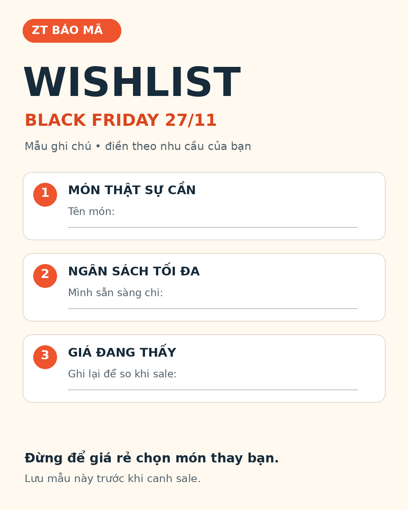
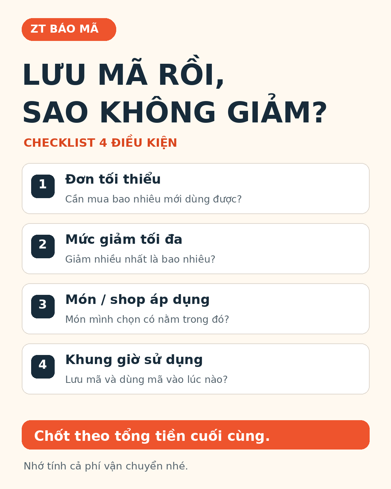

# Ba bài Threads — ZT báo mã

Trạng thái: đã soạn, kèm ảnh; chưa đăng thêm hoặc đặt lịch. Dùng từng bài theo phản hồi thực tế, không đăng cả3 liên tiếp. Link mời C03 hết23:59:59VN30/11/2026. Hai ảnh đầu là mẫu/checklist tự thiết kế, ảnh thứ ba chụp thật guide617.

## ZT-BF-C01 — Hỏi chuyện / wishlist

Black Friday 27/11, mọi người đang chờ giảm món gì nhất? 🛍️

Thử ghi trước 3 thứ: món thật sự cần, số tiền tối đa muốn chi và giá đang thấy. Đến lúc sale, nhìn lại sẽ đỡ bị cuốn vào món “rẻ mà không cần”.

Để lại một món + ngân sách ở dưới nhé 👇

Mục tiêu quan sát: Phản hồi nêu món cần mua và ngân sách; chưa tính là khách dùng bot.

245 ký tự. Trạng thái: chưa đăng.

## ZT-BF-C02 — Giải đáp / điều kiện mã

Lưu mã Shopee xong mà thanh toán vẫn không giảm? Thử kiểm 4 chỗ này trước:

• Đơn tối thiểu.
• Mức giảm tối đa.
• Món/shop được áp dụng.
• Giờ dùng mã.

So tổng tiền cuối, gồm cả phí ship, rồi hãy chốt. Đừng mua thêm món không cần chỉ để đủ điều kiện mã 🛒

Mục tiêu quan sát: Câu hỏi cụ thể về cách áp mã; không hứa mã áp dụng cho mọi tài khoản.

255 ký tự. Trạng thái: chưa đăng.

## ZT-BF-C03 — Mời vào kênh

Có ai muốn canh Black Friday 27/11 cùng nhau không? 🛍️

Mình có kênh ZT báo mã để xem mã Shopee, món tham khảo và điều kiện áp dụng:
https://t.me/+02gPhoNuEjcxMmJl

Có mã hợp món mình cần thì chốt, không cần mua cho bằng được nhé.
Mã có thể hết lượt/tùy tài khoản. Kênh có link tiếp thị liên kết.

Mục tiêu quan sát: Người vào kênh và dùng Cashbot; tổng member chưa chứng minh đến từ bài này.

296 ký tự. Trạng thái: chưa đăng.

Không dựng giá/mã/lượt mua hoặc kể trải nghiệm sử dụng giả. Nếu trả lời người hỏi món cụ thể, kiểm giá/điều kiện thật trước khi dẫn link. Các chỉ số hoạt động chưa phải doanh thu hay khách mua thật.
